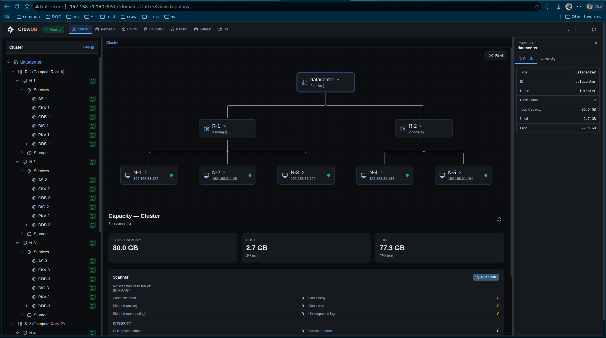
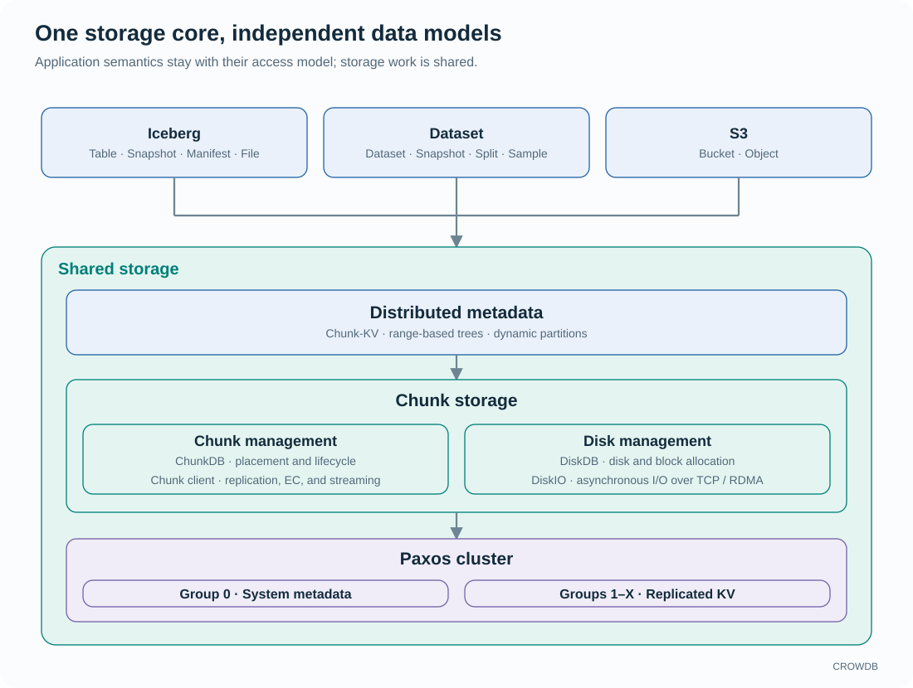

<!-- Copyright 2026-present Gian <crow.db@outlook.com> -->
<!-- Licensed under the Apache License, Version 2.0. -->

# CROWDB

 

**Distributed storage for Iceberg tables, AI datasets, and S3 objects.**

CROWDB brings native table and dataset semantics to a shared storage core. It owns the path from metadata publication to physical I/O, so catalog operations, data placement, buffer movement, and recovery can be designed together.

Access Server and OCI container deployment are implemented, with deployments tested on physical Linux hosts. A shared Web console and CLI manage the cluster, services, and storage.

[Quick start](https://crowdb.dev/docs/quickstart/) · [Design](doc/design/README.md) · [Deployment](container/oci-image/README.md) · [Website](https://crowdb.dev/)

## What you can build on it

- **An Iceberg lakehouse.** Use a native REST catalog and file storage integration with compatible analytical clients. Tables, snapshots, manifests, and files belong to the same storage system, connecting table publication with file cleanup.
- **Dataset readers and training pipelines.** Organize datasets into immutable Snapshots, use Splits to select samples, and read the fields each workload needs. Rust and Python clients support portable HTTP access or trusted native access with retained host buffers.
- **S3 applications.** Use familiar bucket, object, and multipart operations. Large transfers stream through bounded buffers; small writes share physical storage work.

## Why the architecture matters

CROWDB separates replicated control state from range metadata on shared storage. Paxos-KV makes durable decisions; Chunk-KV lets metadata serving move independently of its stored pages and journal. The Tree engine understands distributed versions, and the Chunk layer supplies placement, protection, and streaming for all access models.

That control extends to the data path. The native SDK and TCP/RDMA transport preserve buffer ownership across asynchronous work, creating opportunities to avoid staging copies and bound memory across the stack. Mirror and erasure-coded layouts provide different choices for write cost, recovery, and capacity.

Read the [design overview](doc/design/design-crowdb.md) for CROWDB's strengths and the [architecture](doc/design/design-crowdb-architecture.md) for the mechanisms behind them.

## Run CROWDB

- **Try Iceberg or S3:** follow the [quick start](https://crowdb.dev/docs/quickstart/) or the [local node and client guide](container/single-node-container/README.md).
- **Build and deploy containers:** the [OCI guide](container/oci-image/README.md) covers shared images, local clusters, persistent storage, and lifecycle.
- **Deploy on physical Linux hosts:** use the [host deployment guide](container/oci-image/README.md#linux-host-deployment).
- **Use Dataset from Python or Rust:** start with the [HTTP SDK](sdk/README.md), or use the [native SDK](lib/crowdb-sdk-native/README.md) inside a trusted deployment.

The [access acceptance guide](app/crowdb-access-server/tests/README.md) and [E2E guide](e2e-test/README.md) describe tested clients, deployment scenarios, and restart checks. Compatibility depends on the interface and operation; the native SDK exposes host buffers, not direct GPU delivery.

CROWDB is a development release. Use disposable data for evaluation; production use and on-disk upgrade compatibility are not supported.

## Explore and contribute

- [Product design](doc/design/design-crowdb.md): workloads, scope, and advantages.
- [Design library](doc/design/README.md): architecture and component articles.
- [Contributing](CONTRIBUTING.md): environment, validation, and development workflow.
- [Demos](https://crowdb.dev/demo/): see CROWDB in use.

## AI-assisted development

The code in this project was written with AI assistance. The architecture, naming, module boundaries, and trade-offs remain human choices. AI is the compiler. The intent is mine.

## License

Licensed under the [Apache License 2.0](LICENSE).
