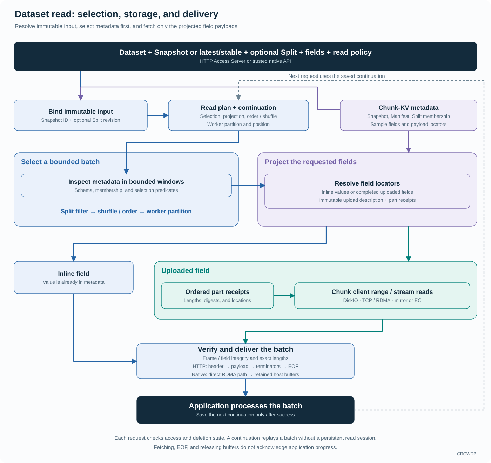

<!-- Copyright 2026-present Gian <crow.db@outlook.com> -->
<!-- Licensed under the Apache License, Version 2.0. -->

# CROWDB - Design: Dataset Storage

CROWDB's Dataset storage is built around datasets, samples, and fields. A training application asks for selected samples from a fixed dataset version, with the fields and worker assignment it needs. The storage system carries that selection down to the payload reads, so a batch does not have to begin as a walk through a directory of small files.

Iceberg integration implements an established table format and catalog interface. CROWDB Dataset defines its own sample-oriented storage contract: immutable input, field projection, Split selection, worker partitioning, and resumable reads. It is independent of Iceberg tables and S3 buckets, and does not require a training framework's data types to become storage types.

`crowdb-access-dataset` owns that model and its publication rules. Chunk-KV stores the metadata, while Chunk storage holds larger field payloads. Trusted training processes can use the native SDK to read directly from storage nodes into host buffers over RDMA or TCP. Direct GPU-memory delivery is future work.

## Small samples do not need small physical files

A file-per-sample layout makes a batch perform repeated path resolution, file metadata access, open/close work, and small payload reads. Packing samples into archives can reduce that overhead, but moves indexing, selection, and update organization into another application layer.

CROWDB gives samples and fields identities in its distributed metadata and aggregates their bytes in shared Chunks. Small fields can remain inline. Eligible uploaded payloads use the shared small-object writer, which batches many objects across a bounded set of pipelines and active chunks. Each field keeps its own location and integrity information while allocation and physical I/O are shared.

An independently selectable sample therefore needs no filesystem inode or exclusive physical chunk. Dataset reads resolve sample metadata and payload ranges directly.

The benefit extends beyond file counts. Field projection can skip an image when only a label is needed, Split selection can narrow the sample set before payload I/O, and read batches can aggregate the selected work. Small-object efficiency becomes part of the storage design rather than a packaging convention every training job must maintain.

## Immutable input for repeatable work

A Dataset groups immutable Snapshots of samples. Splits define selected sample sets within a Snapshot, with explicit revisions so a running job can retain the selection it chose. Each sample contains named fields; the Snapshot's Manifest records those samples and fields, whose values can be bounded inline data or references to stored payload.

For example, a sample may have an image payload, a label, and preparation metadata. A read can select the label alone without transferring the image. A subsequent training job can use the same Snapshot with a different field projection or Split. The storage model captures identity and selection; decoding an image or constructing a tensor remains application work.

Resource preparation and head publication are separate operations. A client can prepare a complete immutable Snapshot, inspect it, and then conditionally select it as the Dataset head. Another publisher changing the head produces a conflict that the application can resolve deliberately. Preparing a new version does not silently replace the input of a running job.

## From a read plan to selected payloads

A read first resolves `latest` or `stable`, if used, to an immutable Snapshot ID and binds any selected Split revision. These names are mutable pointers; subsequent batches use the resolved IDs. The read plan fixes sample selection, projected fields, ordering or deterministic shuffle, worker partitioning, and batch policy. A continuation carries that binding and the current position, allowing another server to replay the same batch.

Workers can restart with a saved continuation without keeping a server-side read session alive. The continuation does not retain storage: deletion rejects new reads and defers physical cleanup for a grace period. Already admitted transfers may finish during that period; a long-running job must keep its input available independently of its saved position.

Selection inspects bounded metadata windows in Chunk-KV. Split filtering precedes deterministic shuffle and worker partitioning; field projection identifies the values the application actually requested. The reader does not load a complete Manifest or fetch every field merely to build one batch.

Field locators connect the read path to the data prepared by the write path. An inline field is already in metadata. An uploaded field resolves its immutable completed-upload description and ordered part receipts, then reads the referenced Chunk ranges or streams through the Chunk client and DiskIO. Readers check part lengths and digests, and verify the complete field before reporting success.

Delivery remains bounded through metadata selection, payload windows, and held buffers. HTTP streams a header, payload frames, field endings, and a batch ending; successful completion also requires EOF. The native path uses the same Dataset selection and storage semantics with retained host buffers. After processing the verified batch, the application saves the next continuation. Fetching, EOF, and buffer release do not acknowledge application progress.

## Shared payloads need explicit retention

Dataset versions and compositions can refer to existing payloads. Reuse avoids copying the same content merely to produce another logical view, but it makes deletion a storage concern. CROWDB tracks the owners and retained resources needed to reclaim data safely.

The same principle applies to Split revisions. Changing the current Split does not rewrite field bytes. Removing historical membership metadata and reclaiming payload storage are different operations, with different owners. This lets dataset organization evolve without turning each edit into a bulk data movement job.

## RDMA keeps the training data path direct

In an internal training cluster, the native SDK embeds the Dataset access library in the application. It resolves metadata and reads Chunk payloads directly from DiskIO nodes over the configured transport. With RDMA enabled, registered buffers can carry the received bytes into the application. This removes the Access Server relay and its additional network transfer.

Registered buffers and retained ownership carry the result into the application without an extra SDK copy on eligible paths. The useful optimization is the whole chain: select fewer bytes, aggregate small payload work, transfer directly, and keep the received allocation alive until its consumer finishes.

The current native interface delivers host buffers that can stay valid through an asynchronous host-to-device copy. It does not expose GPU pointers or direct GPU delivery. See the [native SDK design](design-crowdb-sdk-native.md#extend-the-direct-path-toward-gpu-memory) for the proposed extension.

## Portable access uses the same Dataset model

The [HTTP SDK](../../sdk/README.md) packages portable Rust and Python clients. Rust owns transfers, integrity checks, retries where appropriate, and read progress; Python exposes synchronous and asynchronous interfaces.

The native Python binding is a separate distribution for trusted deployments with internal storage access. HTTP and native clients share Dataset identities, selection, and publication semantics, so choosing a transport does not require rebuilding the dataset organization.

Training frameworks retain responsibility for tensor decoding, augmentation, and accelerator scheduling. CROWDB supplies the part that benefits from storage-level coordination: repeatable sample selection, efficient small-payload organization, and direct bounded I/O. See the [Dataset source](../../lib/crowdb-access-dataset/src) and [SDK examples](../../sdk/README.md#python).
