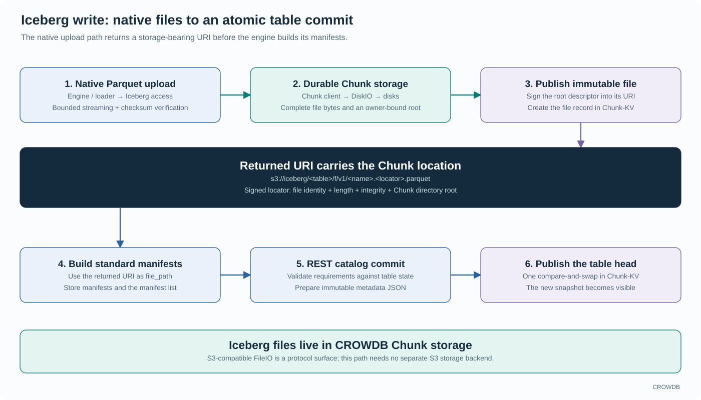
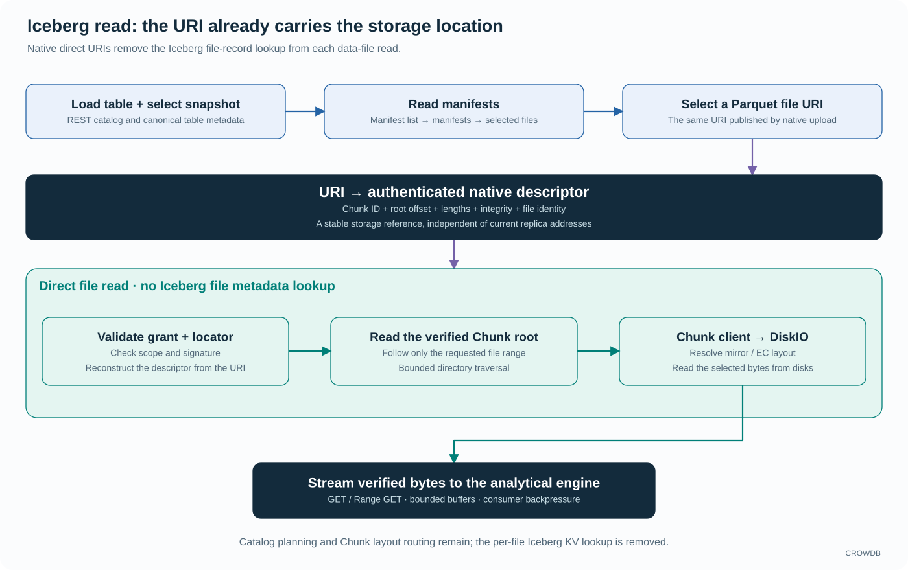

<!-- Copyright 2026-present Gian <crow.db@outlook.com> -->
<!-- Licensed under the Apache License, Version 2.0. -->

# CROWDB - Design: Native Iceberg Storage

CROWDB stores Iceberg tables, snapshots, manifests, and files directly on its distributed storage core. `crowdb-access-iceberg` provides the REST catalog and file interface; the Chunk client and DiskIO store the bytes. Analytical engines retain query planning and execution. There is no separate S3 storage backend in this path.

A native upload returns a signed URI that carries the file's Chunk location. Once a manifest selects that URI, the file endpoint can reconstruct the storage descriptor without another Iceberg file-metadata lookup. The URI saves a namespace round trip while preserving standard manifests and table metadata; it does not bypass the file endpoint or grant access by itself.

## Names can change without moving table data

Catalogs contain namespaces; namespaces contain named tables. CROWDB gives these objects stable storage identities. A table name resolves to that identity and its published table metadata.

A rename changes the name mapping while preserving the table's storage identity. File references do not need to follow a renamed directory across physical disks. This keeps administrative changes proportional to metadata work and protects the distinction between a readable name and the owner of stored data.

Table metadata records snapshots; manifest lists and manifests identify the files that belong to a snapshot. Canonical Iceberg metadata defines the recoverable table state. Derived indexes can accelerate access, but do not become a second definition of the table. CROWDB can therefore change physical placement without changing the table format an engine reads.

## From an engine write to a published table

The native loader streams Parquet bytes through the Iceberg upload interface into Chunk storage. Completion verifies the content and seals an immutable, owner-bound directory root. CROWDB signs that root descriptor into the returned URI and publishes the file record. The record supports ownership, listing, and cleanup; the URI already contains the information needed to reconstruct the read descriptor.

The loader uses the returned URI as the file reference in standard manifests, then stores the manifest list and submits the table update to the REST catalog. The catalog validates the requirements, prepares immutable metadata JSON, and publishes the new table head with one compare-and-swap (CAS) in Chunk-KV. The head identifies the current table metadata. File transfers proceed independently; the atomic table decision stays small.

S3-compatible FileIO requests terminate at CROWDB's Iceberg file interface. They reach native Chunk storage directly and retain Iceberg file ownership and lifecycle. The familiar protocol gives engines an integration point without inserting a separate object-storage service between the catalog and its files.

## Read the location already in the URI

A reader first selects a table snapshot and follows its manifest list and manifests. For a native direct file URI, the locator contains the file identity, length, integrity information, and Chunk directory root. The file endpoint verifies the request's grant and the locator signature, reconstructs the descriptor locally, and reads the requested byte range through the Chunk client and DiskIO.

This is a useful optimization at the scale of an analytical scan. A URI selected from a manifest is already a storage reference, so opening each data file does not require another Iceberg KV query to discover its location or state. Large files keep their extent directory in Chunk storage, allowing a bounded locator and bounded range traversal even when the file spans many extents.

The locator identifies stable storage, while the Chunk layer resolves the current replicated or erasure-coded layout. Replica repair and physical placement can therefore evolve without rewriting every manifest reference. The locator signature protects the descriptor's integrity; a separate request grant authorizes access. The endpoint also probes the owner-bound directory root, preventing an old URI from reading a different file after storage reuse.

Ordinary SDK writers that choose a logical filename before upload keep that filename and resolve its file record on read. The direct-URI optimization applies to the native upload path, which returns the final URI before manifests are constructed. Both paths use CROWDB's own storage.

## File ownership makes cleanup part of the design

File cleanup uses table ownership and retained metadata to decide what can be reclaimed. That connection matters after interrupted writes and table retirement: the storage system can associate unfinished physical work with the table and file that created it. Cleanup still has to respect readers, retention, and authorized operations.

## Small files share physical storage work

Iceberg mixes large data files with small manifests, metadata documents, and incremental outputs. CROWDB gives them different physical treatment while preserving their independent file identities. Small metadata can stay inline in distributed KV storage. Eligible chunk-backed writes use shared small-object pipelines, allowing many files to share Chunk allocation and I/O; large writes use dedicated pipelines.

This avoids making a small file pay for its own physical storage container. Batching and shared chunks reduce per-file allocation overhead, while manifests continue to describe ordinary immutable files. The table model remains convenient for engines, and the storage layer can aggregate work at a much larger granularity.

## Why integrate the catalog and storage?

Some deployments compose an independent catalog with an object store. CROWDB brings table publication and file storage under one design, making the returned URI, durable completion, and cleanup agree at their source. Direct locators are one concrete payoff: the write path prepares the information that makes later reads cheaper.

Small control records can remain in distributed KV storage while larger immutable metadata and file content use Chunk storage. Catalog operations enforce metadata size and preparation limits; direct locators keep file-open work independent of a separate file-record lookup.

The [access acceptance guide](../../app/crowdb-access-server/tests/README.md) and [ecosystem matrix](../../e2e-test/clients/ecosystem/README.md) describe the supported client and engine combinations.

Implementation entry points are the [direct locator codec](../../lib/crowdb-access-iceberg/src/file/direct_location.rs), [file read handler](../../app/crowdb-access-server/src/iceberg/file_http/read.rs), and [table commit](../../lib/crowdb-access-iceberg/src/commit/direct.rs). The [architecture](design-crowdb-architecture.md) shows how metadata and file traffic reach the shared storage services.
