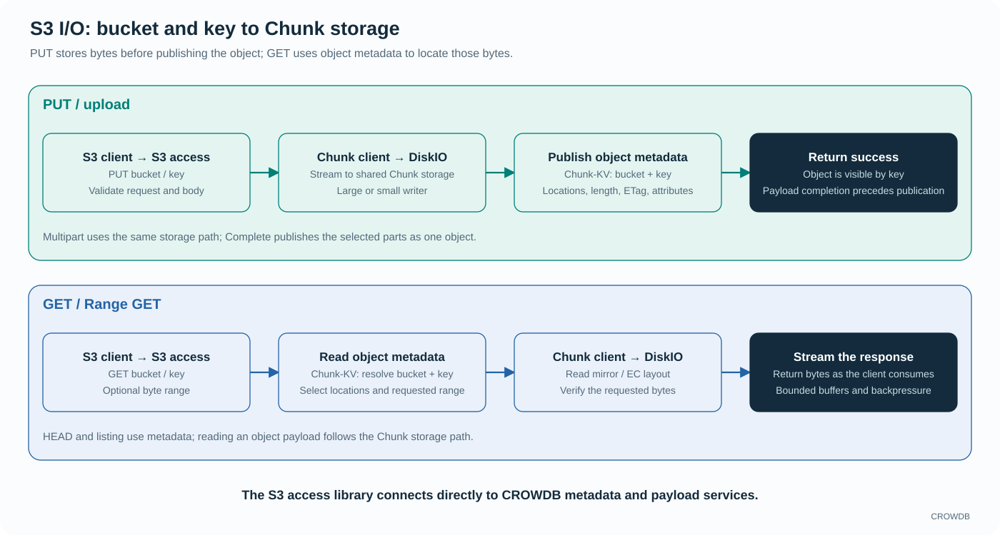

<!-- Copyright 2026-present Gian <crow.db@outlook.com> -->
<!-- Licensed under the Apache License, Version 2.0. -->

# CROWDB - Design: Access Server and S3

Access Server hosts CROWDB's Iceberg, Dataset, and S3 network interfaces. It supplies the access libraries' runtime dependencies and manages listeners and process shutdown. The libraries implement storage operations and publication rules; the server's protocol adapters authenticate and translate network requests.

This arrangement keeps the public interface close to the underlying storage. The S3 library can stream directly into the Chunk client and publish object metadata through Chunk-KV. Iceberg and Dataset use the same infrastructure with their own publication rules.

## Buckets and objects

`crowdb-access-s3` organizes objects by bucket and key. Each object record holds its metadata and the reference to its stored payload. Physical disk topology remains below the S3 interface.

An upload prepares the payload, then publishes the complete object record under its bucket and key. Overwriting replaces that record; subsequent lookups find the new object data. Listing operates on the object namespace without scanning disks.

## S3 I/O follows two direct paths

**PUT:** the S3 library validates the request, resolves the bucket, and streams the body through the Chunk client to DiskIO. Once the payload completes and its checks pass, it publishes the object's locations, length, ETag, and attributes in Chunk-KV. The success response follows publication. Large transfers use dedicated writers; small writes share the Chunk client's aggregation pipelines.

**GET / Range GET:** the S3 library resolves the object record by bucket and key, selects its stored locations and requested range, then streams checked payload frames from the Chunk client through the HTTP response. A delivered prefix does not establish success for the complete requested range. HEAD and listing use metadata without fetching the object payload.

The S3 layer connects directly to the metadata and payload services. Namespace lookups remain small, bulk bytes go to the disk-serving nodes, and backpressure follows a slow consumer through the pipeline. Memory is governed by active buffers and outstanding work, so object size does not become a requirement to buffer the entire transfer.

## Multipart upload keeps transfer and publication separate

Multipart upload allows independent part transfers before the final object is selected. Complete resolves the chosen parts and publishes their combined object; abort and cleanup handle unfinished work. An uploaded part is useful preparation, but it does not make a completed object visible on its own.

`crowdb-access-multipart` supplies shared multipart mechanisms. The S3 library retains the meaning of an S3 Complete request and its response. Iceberg and Dataset can reuse transfer machinery without inheriting S3 namespace or overwrite semantics.

## Compatibility and the deployment boundary

The S3 interface covers core bucket and object operations, streaming reads and writes, range access, copy, listing, deletion, and multipart transfer. It supports signed requests and presigned access. S3 object versioning is not supported. Unsupported operations return protocol errors; the interface is not the entire AWS S3 product.

The configured listener currently shares a tenant namespace among its accepted credentials. Signature verification authenticates requests; per-user IAM policies and bucket ACL isolation are outside that interface. Deployments must choose their exposure and trust boundary accordingly.

Standard clients are a major advantage of S3 access. The [container examples](../../container/single-node-container/README.md#tested-s3-client-recipes) show a concrete entry point, and the [access acceptance guide](../../app/crowdb-access-server/tests/README.md) describes the client and engine checks. HTTP remains the portable application boundary; trusted applications with direct service access can use the [native SDK](design-crowdb-sdk-native.md).

## Why keep access libraries separate from the host?

The host manages network adapters, runtime resources, and listener lifecycle. The libraries manage storage semantics. A shared host can run several interfaces without requiring table commits or Dataset reads to pass through the S3 object API. The Dataset and S3 libraries also serve trusted applications through the native SDK.

This creates more explicit interfaces inside the codebase, but it preserves freedom where workloads differ most: authentication, naming, publication, and read selection. See the [host source](../../app/crowdb-access-server/src), the separate [Iceberg](design-crowdb-access-iceberg.md) and [Dataset](design-crowdb-access-dataset.md) designs, and the [S3 library](../../lib/crowdb-access-s3/src).
