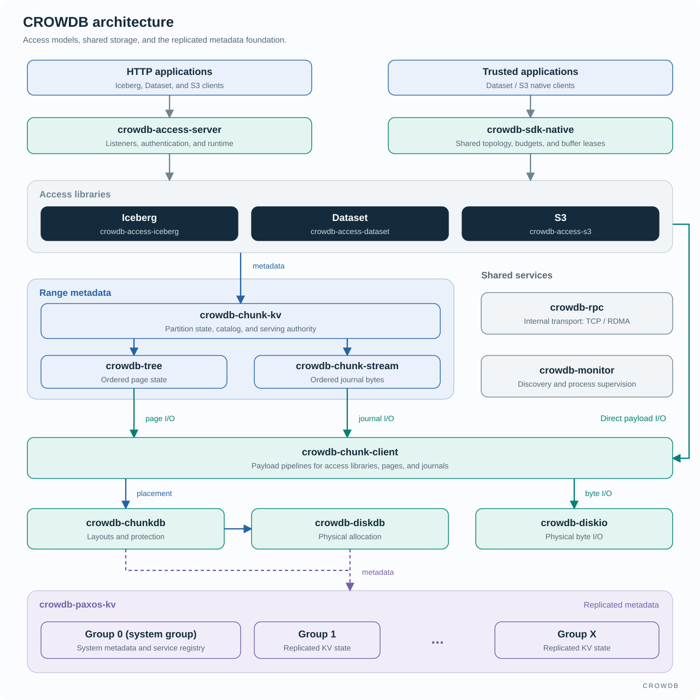

<!-- Copyright 2026-present Gian <crow.db@outlook.com> -->
<!-- Licensed under the Apache License, Version 2.0. -->

# CROWDB - Design: Architecture

CROWDB separates application metadata, payload placement, and physical I/O so each can scale and recover at the right granularity. Its access libraries connect those services into complete table, dataset, and object operations. The architecture follows the decisions a storage system must make: what data means, who may change it, where its bytes live, and how those bytes survive.

## The component map

Iceberg, Dataset, and S3 form one access layer with separate access libraries. Range metadata sits above the Chunk client: Tree pages and ChunkStream journals use its shared storage path, while access libraries can reach the Chunk client directly for payload I/O. Solid arrows show the main calls and data paths; dashed arrows show replicated metadata dependencies.

The Rust projects own service coordination and application behavior. C++ implements the Tree engine, DiskIO server, and RPC engine, with scoped FFI interfaces exposing those capabilities to Rust. `crowdb-protocol` supplies shared identifiers and wire types; `crowdb-common` supplies common utilities. Their types support the owning services without taking over their decisions.

## Keep each decision close to the work it controls

Composing independent storage systems can make the same request pass through several namespaces, location indexes, and forwarding services. CROWDB's layers divide responsibilities inside one storage platform. The access library owns the table, sample, or object; Chunk-KV indexes application metadata; ChunkDB and DiskDB own physical placement and allocation; DiskIO moves the bytes.

That division keeps coordination out of the bulk-data path once a location is known. An Iceberg direct URI supplies its native file descriptor. A Dataset batch selects fields before fetching payloads. A trusted native client sends I/O directly to storage nodes. Each operation uses the metadata it needs without making every byte traverse every service.

Shared storage also separates serving capacity from storage capacity. A range can split or change owner while retaining its page backing, so a new metadata server can take on work without first receiving a private copy of the complete index. Adding disks and relocating physical Chunks remain separate operations. This lets growth in metadata traffic and growth in stored bytes be addressed at their respective layers.

## Metadata and control

[Paxos-KV](design-crowdb-paxos-kv.md) maintains replicated key-value (KV) state with Multi-Paxos, a write-ahead log (WAL), and the Tree engine. Group 0 is the system group, containing metadata such as service registrations and ownership information. Nonzero groups hold other replicated KV state, including storage-service metadata. Payload I/O reaches DiskIO through the Chunk client independently of this metadata path.

Its write path runs multiple slots concurrently. Each can reach a durable quorum independently, and the Tree engine preserves per-key slot ordering when application completes out of order. Independent blind updates therefore use concurrency through replication and storage, while reads and recovery retain their required progress boundaries.

[Chunk-KV](design-crowdb-chunk-kv.md) serves range partitions whose pages and journals live in shared Chunk storage. Its server manages the catalog, partition ownership, and range changes; its client routes requests to the appropriate server. A new owner can recover a partition from shared storage instead of requiring the old serving process to remain alive.

The two models address different costs. Replicated control state supports coordination and bootstrap. Shared storage supports larger range metadata whose serving placement can change independently of its durable backing. Bootstrap must establish the control services needed to discover and operate the storage services; the design does not require Group 0 to bootstrap from the Chunk-KV service it will later coordinate.

[Tree](design-crowdb-tree.md) supplies ordered storage to both models. It materializes the work selected by its caller without adding a separate mutation redo WAL. Each KV layer owns its journal, while Tree reports the durable coverage of its persisted state. Recovery combines that state with the required journal suffix; retention follows the caller's recovery obligations. The engine and its external log are designed together, avoiding repeated mutation logging inside Tree.

[ChunkStream](design-crowdb-chunk-stream.md) supplies the durable byte stream used by Chunk-KV's journal. Ordered KV state, append streams, and Chunk payload storage are reusable foundations below the access models. A future stream interface could build on the same append, rollover, recovery, and trim machinery, with its own public API and record semantics.

## Payload placement and movement

Four projects divide the physical storage work:

- [ChunkDB](design-crowdb-chunkdb.md) owns Chunk metadata, placement, protection layouts, and lifecycle transitions.
- [Chunk client](design-crowdb-chunkdb.md#two-write-paths) runs the payload pipeline, including buffering, encoding, streaming, and reads.
- [DiskDB](design-crowdb-diskdb.md) allocates and accounts for physical disk space through durable disk and zone records.
- [DiskIO](design-crowdb-diskio.md) executes byte reads, writes, and synchronization on the addressed storage devices.

The split keeps placement decisions out of every data packet. Once a client has the required location and authority, it transfers payload to DiskIO. ChunkDB remains responsible for the layout's lifecycle, while DiskDB remains responsible for the underlying allocation. A table rename therefore has no reason to rewrite a storage block, and a physical repair has no reason to reinterpret an Iceberg commit.

Logical key order also stays independent of physical byte placement. A prefix can occupy adjacent metadata ranges while its referenced payloads are spread across many nodes and disks. Range partitioning keeps listing efficient; Chunk placement distributes capacity, I/O, and protection. The storage layout can change without destroying the namespace order that clients use to find their data.

## Representative operations through the architecture

### Committing an Iceberg table

An engine writes immutable files through the Iceberg file interface into Chunk storage. Native upload returns a signed URI containing the Chunk directory root; the loader places that URI in standard manifests. The catalog checks the table update's requirements and publishes the new head with one compare-and-swap (CAS). After snapshot and manifest selection, the authenticated file endpoint reconstructs the storage descriptor from a direct URI without another Iceberg file-record query.

Catalog and FileIO coordinate identity, publication, small-file placement, and cleanup within CROWDB. This direct URI avoids a metadata lookup; the file endpoint still serves the HTTP transfer. See [Iceberg](design-crowdb-access-iceberg.md).

### Reading a Dataset batch

The access library binds a Snapshot and Split, selects sample metadata, and projects the requested fields. Inline values are already available; uploaded fields resolve to Chunk ranges. The Chunk client reads only those payloads, preserving bounded buffers through delivery.

The native path runs that access-library work inside the training process and reads from storage nodes over RDMA or TCP. It returns retained host buffers and eliminates the Access Server relay. Sample identities and shared Chunk storage also avoid requiring one filesystem file per sample. See [Dataset](design-crowdb-access-dataset.md) and the [native SDK](design-crowdb-sdk-native.md).

### Publishing an S3 object

The access service authenticates the request and resolves the bucket and key. The Chunk client streams the body through bounded buffers to its storage layout. After the payload satisfies the required completion conditions, the S3 library publishes the object record under its bucket and key. Subsequent reads resolve that record and stream the object payload.

Payload preparation can overlap across uploads. Publication remains a small metadata decision. An incomplete upload never becomes a complete object merely because some disk writes finished. The same separation makes multipart upload useful: parts can arrive independently, while Complete selects the object that readers will see.

### Changing a Chunk-KV partition owner

A candidate server opens a pinned shared Tree base and catches up through the WAL while the source continues serving. Once preparation is sufficient, fencing fixes the final source boundary and a higher epoch transfers authority through the catalog. The target completes the remaining catch-up, and clients follow the updated routing.

Shared backing removes a full private range copy from the transfer's critical path. Local splits use the same advantage to create smaller serving ranges before balancing moves their owners. This makes the ordered range model useful for growing namespaces whose listing semantics should stay stable as placement changes.

## Resource control reaches across the stack

Large objects and training batches make buffer lifetime a system concern. The Chunk client bounds preparation, queued payloads, outstanding I/O, and erasure-coding (EC) work. RPC accounts for registered memory and transport queues; the native SDK also accounts for buffers held by the application after a read completes. These limits cover different resources and release them at their actual completion or ownership boundaries.

For example, a training worker may finish receiving a batch while still holding it for decoding or a host-to-device copy. Those allocations remain charged until release. When capacity is occupied, later reads wait or reach their deadline, and backpressure limits further production. The design follows memory through useful application work, making sustained concurrency manageable even when the consumer is slower than the network.

RDMA is the core high-performance RPC path; TCP provides the compatible fallback. Registered buffer ownership can continue through eligible storage and native-consumer handoffs. Encoding, reconstruction, HTTP adapters, and application conversions still have their own costs. The [RPC design](design-crowdb-rpc.md) explains how transport selection and memory ownership support this path.

## Deployment and recovery

An OCI image packages each node without requiring a particular container runtime or orchestrator. The recommended performance-oriented deployment uses host networking and host block devices; the runtime controls CPU and memory through cgroups. Persistent data and node identity remain outside the replaceable image. See [container deployment](design-crowdb-deployment.md).

`crowdb-monitor` discovers nodes and supervises local processes. Group 0 stores system metadata. Shared console operations let the Web UI and CLI act on the same management model. Process observations describe what is running; authoritative records determine what may run and serve.

Recovery follows those ownership boundaries. Consensus restores agreed metadata; partition recovery restores range state; Chunk repair restores physical protection; the monitor restores processes. This division makes a large failure understandable as related tasks with distinct owners. See [cluster management](design-crowdb-monitor.md).
