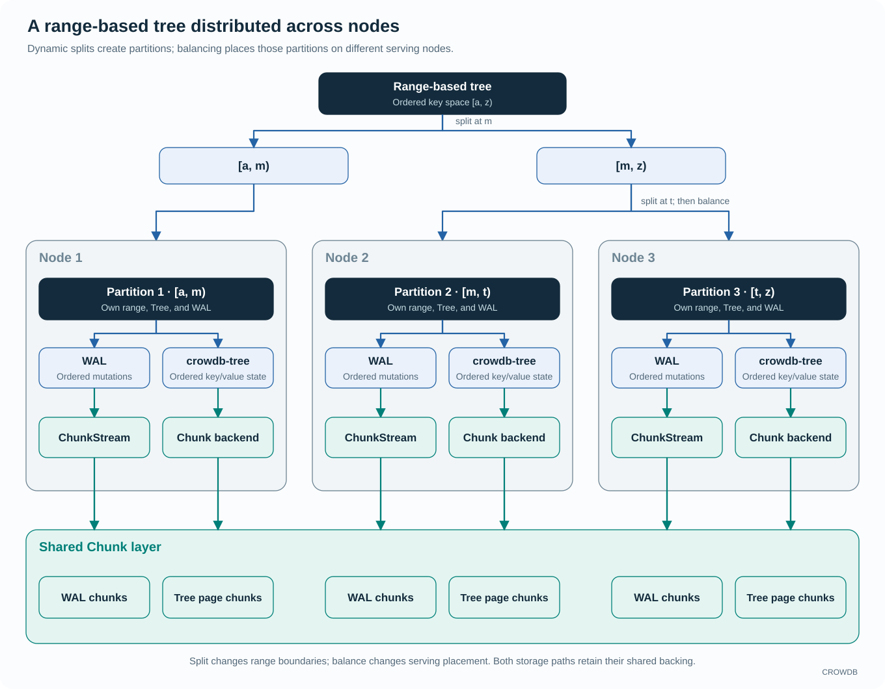

<!-- Copyright 2026-present Gian <crow.db@outlook.com> -->
<!-- Licensed under the Apache License, Version 2.0. -->

# CROWDB - Design: Chunk-KV

Chunk-KV serves an ordered key-value index divided into range partitions. Partitions can split as the index grows and move between serving nodes. Their Tree pages and write-ahead logs (WALs) remain in shared Chunk storage, so a destination can reopen the durable state without first receiving a full private database copy.

The design targets metadata behind table files, datasets, and object namespaces. These workloads repeatedly enumerate a prefix, resume from a key, or scan ordered records. Range partitioning keeps those operations in the primary index; split and transfer adapt the index's serving placement as demand changes.

## Range partitioning fits a list-oriented system

Hash distribution spreads independent point requests well, but neighboring keys need not share a server or storage order. An ordered listing can then require work across many shards and a merge of their results. Range partitioning preserves that neighborhood: a prefix maps to contiguous intervals, scans advance in key order, and clients cross partition boundaries as they progress.

That fit matters throughout CROWDB. Object prefixes, table namespaces, and Dataset metadata all benefit from ordered traversal. A range tree lets the system build listing, pagination, and bounded scans on its primary index instead of maintaining a separate organization just to recover ordering.

Ranges still need active management. Sequential inserts can concentrate on the newest range, and skewed access can make one partition hotter than its neighbors. Splitting creates smaller placement units; transfer distributes those units across nodes. A single hot key remains a single-key workload. CROWDB accepts this trade-off because ordered access is part of the product's core behavior, and invests in making range changes inexpensive and recoverable.

## Ordered names do not constrain payload placement

Range partitioning organizes the metadata keys. The referenced file, sample, or object bytes use Chunk layouts chosen independently by ChunkDB. A large object prefix can therefore retain an ordered index while its payloads occupy many nodes and disks. Logical adjacency does not require physical co-location.

Consider objects named `photos/2026/0001`, `photos/2026/0002`, and `photos/2026/0003`. Their names are neighbors for listing, but their records may point to different Chunks with layouts spanning different storage nodes. Listing finds the next names through the ordered metadata ranges. Reading an object's body follows its locations through the Chunk client to DiskIO, without sending that body through the metadata range server.

This gives listing and bulk I/O different ways to scale. The index routes a prefix scan through the relevant ordered ranges; payload clients reach the DiskIO nodes selected by each Chunk layout. Physical rebalance or protection changes can update those layouts without reordering the names. Metadata hot ranges still need split and transfer, but their boundaries do not force all referenced bytes through the range server or onto its disks.

## A range-based tree across nodes

Each partition covers a contiguous key range and owns its mutation order, Tree, and WAL. A split divides one range at a key boundary; the retained parent keeps one side and a new child owns the other. The child initially shares the parent's serving node. A later balance operation can move it to another node, so partition count and node count can evolve independently.

`crowdb-chunk-kv` combines two storage paths. Its WAL uses [ChunkStream](design-crowdb-chunk-stream.md), which appends bytes across chunks. Its [crowdb-tree](design-crowdb-tree.md) index uses the native Chunk backend to store page data and durable roots in chunks. Recovery opens the stored Tree state and replays the required WAL suffix. Bounded admission controls queued mutations. Both paths use the shared Chunk layer, with separate responsibilities for recovery order and searchable state.

`crowdb-chunk-kv-server` manages the catalog, serving ownership, and partition lifecycle. `crowdb-chunk-kv-client` maintains routing information and composes calls across ranges. A scan crossing a range boundary uses those routing responsibilities; it does not turn the entire cluster into one implicit transaction domain.

## Smooth split reuses the tree already stored

The retained parent keeps its identity, Tree, and WAL. A new child starts from a range-bounded view of a pinned shared base, with the required parent WAL suffix covering writes made during preparation. Parent reads and writes continue while the durable handoff is prepared. Local dispatch then directs each side to its proper writer, and one catalog publication replaces the old range with two adjacent serving ranges.

This makes split primarily a change in range ownership and references. The system can reuse the immutable base, preserve the parent writer, and move the final independent materialization into background work. It avoids making a full rewrite of both halves a prerequisite for publishing the new ranges. Durable transition records let a restart resume the same split, including the writes accepted around its cutover.

Both halves initially stay on the same node. Separating local split from later placement keeps a remote transfer out of the range-boundary change itself. Once the child is independently recoverable, balancing can choose where it should serve.

## Transfer prepares the destination while the source serves

A live transfer pins a shared Tree base and records a matching WAL cursor. The destination opens that exact base and catches up through the source's WAL while the source remains writable. Most preparation can therefore overlap ordinary service; the destination does not first need a private copy of every page on its own disks.

Cutover closes the old owner's admission, drains accepted mutations, and fixes the final source cursor. A higher owner epoch and a published catalog assignment give the destination its authority. The target finishes the remaining WAL suffix before answering reads or conditional mutations. During that catch-up state, eligible unconditional writes can already enter its durable WAL; readers wait within bounded deadlines.

Shared backing removes the full-range copy from cutover, advance catch-up reduces the remaining suffix, and explicit fencing prevents competing owners from acknowledging writes. Transfer still has a cutover interval: draining, remaining replay, and cache warming affect request latency. A shared root makes movement cheaper; it does not make it instantaneous.

## Serving capacity and storage capacity

Adding a metadata server supplies CPU and cache capacity; adding disks supplies storage capacity and physical I/O bandwidth. Split creates ranges that can be placed independently, and transfer lets a new server open those ranges from their shared roots and journal suffixes. Moving a range owner need not relocate its physical Chunks.

For a namespace whose size changes little while listing and update traffic grows, a new server can take selected ranges using their existing backing. It still spends resources on replay and page reads, but its preparation does not require copying the entire persistent index.

If the constraint is disk capacity or physical I/O, operators instead add storage resources and rebalance Chunks. Adding a range server alone cannot increase those disks' bandwidth. Keeping the two operations separate lets the deployment address the resource under pressure, while durable pages remain protected during serving changes. For a large namespace, this makes expansion less tightly coupled to the total size of its persistent index.

## Why both Chunk-KV and Paxos-KV?

Paxos-KV supplies replicated agreement and durable control state. Chunk-KV uses shared storage to separate a range's serving process from its durable pages and journal. These are complementary ways to pay for reliability.

Paxos-KV stores records that manage shared storage, rather than another full copy of every Chunk-KV value. Chunk-KV's Tree pages and journal bytes live in Chunks protected by the storage layer. Its range server handles mutation ordering and index access, while replicated control metadata establishes who may serve the range.

The trade-off is dependence on the shared Chunk services and their latency, availability, and repair behavior. CROWDB accepts that dependency because those services already protect the platform's payload and storage state. The design reuses a substantial storage investment instead of repeating it inside every metadata range.

See the [partition implementation](../../lib/crowdb-chunk-kv/src/partition.rs), [native storage adapter](../../lib/crowdb-chunk-kv/src/partition/native.rs), and [server authority](../../app/crowdb-chunk-kv-server/src/server/authority.rs).
