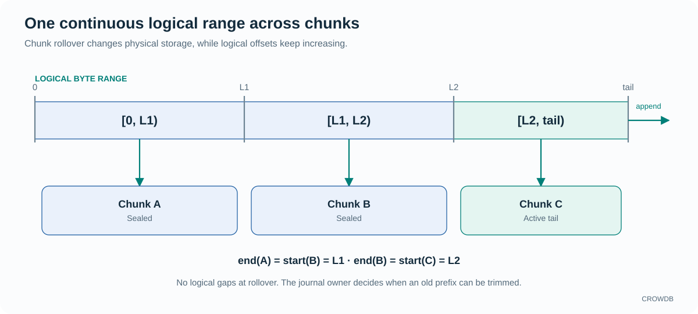

<!-- Copyright 2026-present Gian <crow.db@outlook.com> -->
<!-- Licensed under the Apache License, Version 2.0. -->

# CROWDB - Design: ChunkStream

ChunkStream turns finite mirrored Chunks into one durable, ordered byte stream. It provides stable stream identity, append and offset reads, writer fencing, rollover, recovery, and prefix reclamation. Journals can use that interface without implementing their own distributed physical log storage.

`crowdb-chunk-stream` is a library over CROWDB's metadata and Chunk storage. Chunk-KV uses it for partition journals. The stream understands append ordering and byte validity; its caller understands the records stored in those bytes.

## Logical order across physical chunks

A writer appends to the active tail. Adjacent chunks cover contiguous half-open logical ranges: `[0, L1)`, `[L1, L2)`, and `[L2, tail)`. One chunk's logical end is the next chunk's logical start. Rollover introduces no logical gap and does not reset the offset. Readers can request a logical range spanning several chunks without reconstructing the physical transitions themselves.

Stream metadata records the structure needed to find and recover the tail. A Group 0 lease authorizes one writer, which checks its grant before admission and before acknowledging an append. An expired or fenced writer cannot report successful appends or publish a new tail. Recovery resolves previously submitted I/O and establishes the valid tail before a new writer continues in a fresh Chunk.

An append succeeds after its framed bytes are synchronized to every required mirror and writer authority is rechecked. After an interruption, physical bytes alone do not prove that the complete logical append finished. Recovery validates the framed content to distinguish complete appends from an incomplete tail.

## Journals retain their own meaning

A Chunk-KV journal can encode mutations into the stream and replay them into Tree. ChunkStream does not interpret those mutations or decide when the partition may report a successful update. Its append result is one input to the caller's completion rules.

The journal supplies the record format, mutation order, and the relationship between an applied mutation and a stream position. ChunkStream supplies the ordered byte range and its durable append boundary. Rollover can move later bytes into another physical Chunk while the journal continues using the same logical offset space. Record parsing and physical chunk-chain management therefore remain separate jobs.

Likewise, old stream bytes can be reclaimed only after the owner has established that they are no longer needed. A partition may base that decision on durable Tree state and its recovery requirements. ChunkStream then manages the physical prefix cleanup.

After a restart or owner transfer, the partition reopens its durable Tree state and reads the required journal suffix through logical stream ranges. As its durable recovery point advances and retained dependencies are released, it can authorize trimming an older prefix. Trim advances the logical lower bound first; physical reclamation releases eligible complete Chunks after retained readers and recovery dependencies no longer need them.

## Why use shared chunks for a journal?

A local append file is a natural choice when the journal belongs to one machine. A shared journal supports a serving process that may move: a new owner can recover the same stream through the storage services.

Using CROWDB's Chunk layer also reuses its data protection and physical allocation. The stream needs to manage ordering and boundaries, while the underlying services manage where the bytes live. The cost is remote I/O and dependence on the metadata and storage services needed to open the stream.

## A foundation for another access model

A write-ahead log (WAL) is one application of a durable ordered stream. ChunkStream is currently an internal library, not a public streaming service. A future Stream API could reuse its storage machinery while adding public access, quotas, retry behavior, and delivery semantics.

A record-oriented log adapter could build on that foundation with its own record offsets, producer identity, visibility, and retention rules. A record number would need a mapping to its byte range; a retried producer request would need an identity that distinguishes a repeat from a new append. Those meanings belong above the stream, just as mutation records belong to Chunk-KV's journal.

The existing sequential reader captures a finite readable end. A future subscription or tail-following interface would also need waiting, cancellation, and retention behavior. ChunkStream supplies reusable storage for that work; it does not yet supply those public interfaces.

The [stream implementation](../../lib/crowdb-chunk-stream/src) contains the authority, metadata, and append logic. Its main architectural consumer is [Chunk-KV](design-crowdb-chunk-kv.md).
