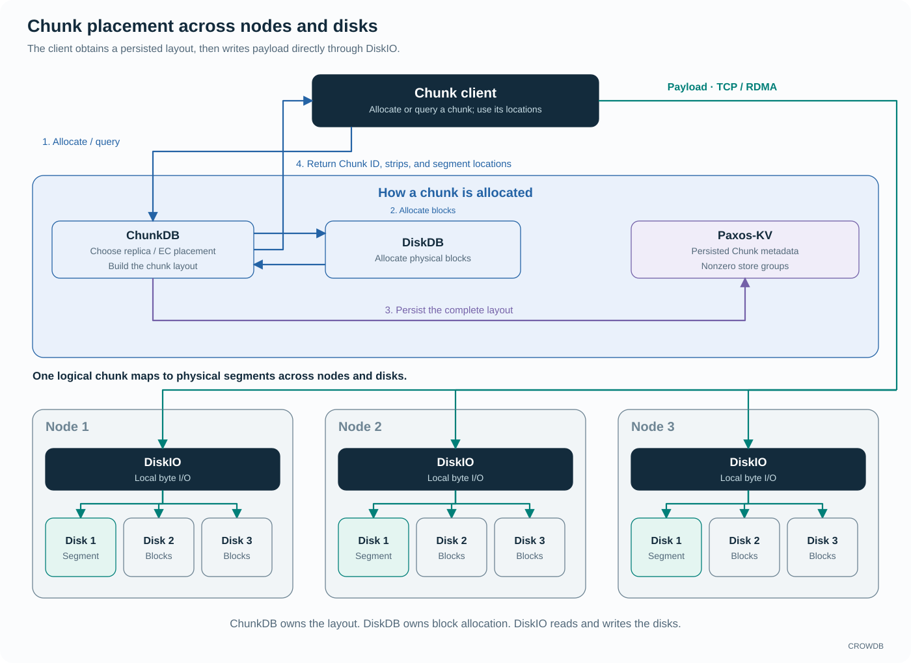
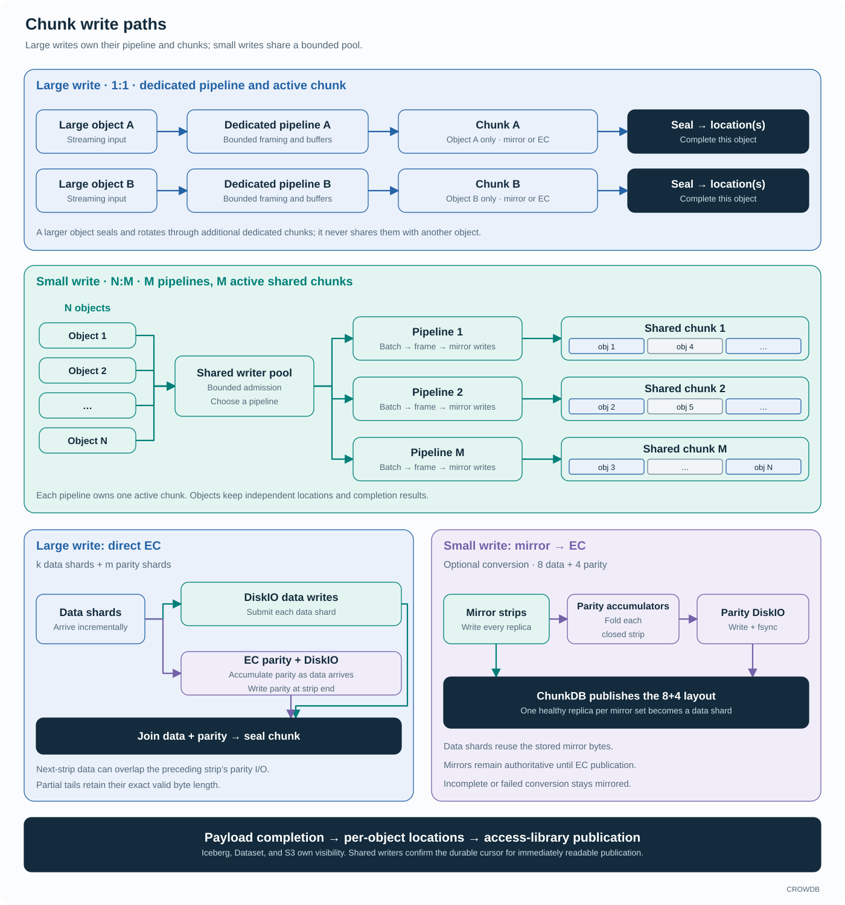
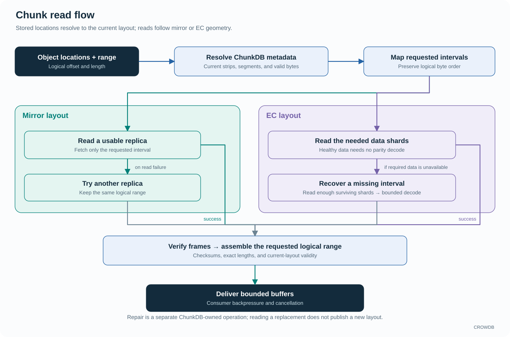

<!-- Copyright 2026-present Gian <crow.db@outlook.com> -->
<!-- Licensed under the Apache License, Version 2.0. -->

# CROWDB - Design: Chunk Storage

CROWDB Chunk storage combines placement, data protection, and payload I/O. ChunkDB owns metadata, allocation coordination, and layout lifecycle. The Chunk client uses those layouts to move bytes directly through DiskIO. Together they provide dedicated large-write pipelines, shared small-write pipelines, replication or erasure coding (EC), and bounded reads.

This puts the protection policy below Iceberg, Dataset, S3, and internal storage. Each can retain its own logical data model while reusing the same placement, repair, and capacity machinery.

## From a Chunk to physical blocks

A Chunk is a logical storage unit divided into strips. Each strip describes a logical byte interval and the physical segments holding its replicas or erasure-coded shards. Placement chooses those segments using the available topology and failure-domain policy; DiskDB supplies the underlying allocations. A Chunk ID identifies storage independently of the table file, Dataset field, or S3 object using it.

`crowdb-chunkdb` manages those records and decisions. `crowdb-chunkdb-client` routes metadata operations to their owning service. `crowdb-chunk-client` performs payload I/O against the selected layout. The metadata service therefore does not need to proxy every byte of a large transfer.

Chunk allocation follows a concrete sequence:

1. The Chunk client requests a new layout from ChunkDB.
2. ChunkDB chooses node and disk-group targets, then asks DiskDB to allocate physical blocks.
3. ChunkDB persists the Chunk ID, strips, segment locations, and lifecycle state in the selected nonzero Paxos-KV store group. Group 0 supplies system metadata such as topology and service registrations.
4. The client receives the layout and sends payload through the target nodes' DiskIO services to their local disks. Later reads resolve the current layout through the Chunk client, using cached metadata or a refresh as needed.

Each node can contain multiple disks. Placement combines segments from those disks according to the required mirror or EC protection and failure-domain policy. Metadata operations establish where the chunk lives; the bulk data path runs directly between the client and DiskIO.

## Two write paths

A large write has a dedicated pipeline and an exclusive active chunk. Input is framed and buffered within bounded budgets. The pipeline writes the selected mirror or EC layout, seals the chunk, and returns its location. A write larger than one chunk rotates through additional dedicated chunks and returns their ordered locations. Those chunks are exclusive to that large-writer operation; a higher-level file or multipart upload can combine several such operations.

This gives a sustained transfer its own progress and backpressure. Preparing the next chunk and submitting independent I/O can overlap with active work, without allocating storage or memory for the entire object in advance.

Small writes share a bounded pool of pipelines, each with its own active chunk. The pool routes admitted objects to an available pipeline, which batches whole objects, frames their data, and writes their ranges to every required mirror. An eligible small object may cross strip boundaries within its chunk, but does not cross a chunk boundary.

Each small object keeps its own location and completion result. A shared chunk may contain many objects, while allocation, physical writes, and chunk rotation are shared across them. The pool can adjust the number of active pipelines within configured limits. This reduces the cost of creating a separate physical container for every small payload while keeping concurrency and retained memory bounded.

## EC follows the write path

For a large write using EC, the strip layout supplies the data and parity widths. Data shards feed incremental parity computation and are submitted to DiskIO as they become available. At the end of a strip, the writer submits its parity shards. The next strip's data writes can overlap the previous strip's parity I/O. Chunk sealing joins the required data and parity completions before exposing the completed locations. Partial tails retain their exact valid byte length.

The small-write path starts with mirrored strips. When automatic conversion is enabled, closed strips incrementally contribute to an EC group. The default conversion geometry is eight data strips and four parity shards, shown in the diagram. The client writes and synchronizes parity, then ChunkDB selects a healthy replica from each mirror set and publishes the EC layout. Those existing replicas become the data shards, so conversion reuses their stored bytes. Mirrors remain authoritative until publication; incomplete groups or failed foreground conversion remain mirrored and can be handled by background conversion.

The two paths put EC at different points in the lifecycle. Large writes can establish their EC representation directly. Small writes first aggregate independently completing objects in mirrored storage, then reduce redundancy overhead across completed strips.

## Completion stays per object

Large-writer completion includes sealing every chunk used by that write. Shared chunks stay open across many small-object completions. Callers that immediately publish readable data use the shared writer's durable completion barrier: the chunk's acknowledged cursor must cover the returned locations. The lower-level mode without that barrier can return earlier and is insufficient on its own for immediately readable publication.

Iceberg, Dataset, and S3 then perform their own metadata publication. Sharing physical storage does not merge their visibility or deletion rules. An open shared writer can retain buffers for repair, and reclamation must account for other objects still using the chunk.

## Read flow

A reader maps the requested logical range through the object's locations and current ChunkDB metadata. It follows the stored strip intervals, exact valid lengths, and current physical segment identities. This allows a location to keep its meaning after a mirror-to-EC layout change.

A mirror read fetches the needed interval from a usable replica and can try another replica when the failure permits a safe retry. A healthy EC read fetches only the data-shard intervals the request needs. If a required data shard is unavailable, the reader obtains enough surviving data and parity intervals to reconstruct that slice within its recovery budget. It does not decode the entire object merely to serve a small range.

Frame checks, exact lengths, and layout validity govern delivery. A streaming reader returns bounded buffers as the consumer pulls; cancellation stops further production, while held buffers retain their owners. A readable prefix is useful for streaming, but complete success requires the validated end of the requested range. Repair remains a separate operation whose allocation and layout publication are owned by ChunkDB.

## Repair is a metadata transition as well as a copy

Rebuilding bytes is only part of repair. The system also needs to identify the work, select the current layout, publish the valid replacement, and eventually release obsolete allocations. ChunkDB owns that lifecycle.

Tasks carry the authority needed to act on their Chunk. Routing and ownership changes must fence old workers, including workers that resume after a long pause. A completed physical copy cannot override a newer layout merely because its original task eventually finished.

Keeping this coordination with Chunk metadata gives recovery a durable place to resume. It also lets foreground reads and writes use published layouts while background conversion or repair prepares their successors.

## Placement and resource control

Explicit layouts let CROWDB change physical protection and placement while retaining a file or object's logical data reference. ChunkDB durably records the exact allocations and pending conversion or repair work. Once the client has a usable layout, it transfers payload directly to DiskIO.

Memory depends on active pipelines, queued objects, outstanding I/O, parity state, recovery scratch, and caller-held allocations. Each has an owner and a budget. Retained buffers can avoid staging copies across eligible handoffs, while framing, alignment, and EC still perform the transformations the storage format requires. Repair and conversion share real disk and network capacity with foreground traffic, so their work is budgeted as part of the same system.

See [placement selection](../../app/crowdb-chunkdb/src/selector), [conversion](../../app/crowdb-chunkdb/src/conversion.rs), [repair](../../app/crowdb-chunkdb/src/repair.rs), the [large writer](../../lib/crowdb-chunk-client/src/writer/large_object.rs), [small writer pool](../../lib/crowdb-chunk-client/src/writer/small_pool.rs), and [reader](../../lib/crowdb-chunk-client/src/chunk/chunk_reader.rs).
