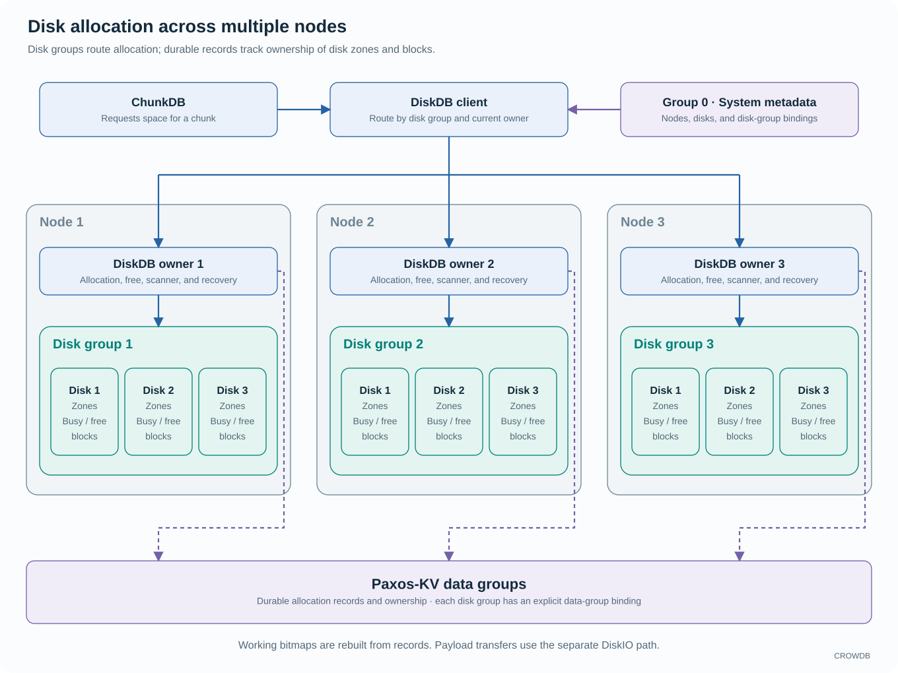

<!-- Copyright 2026-present Gian <crow.db@outlook.com> -->
<!-- Licensed under the Apache License, Version 2.0. -->

# CROWDB - Design: Disk Allocation

DiskDB turns disk capacity into managed allocations. It records which space is owned, which space can be reused, and how disks and zones recover their allocation state. Byte reads and writes are handled separately by DiskIO.

This separation lets CROWDB make allocation a durable metadata operation without putting that operation in the path of every subsequent I/O. ChunkDB requests space for its layouts; payload clients then use the resulting locations to access DiskIO.

## Durable records and working allocation state

`crowdb-diskdb` manages disk groups across multiple nodes. A disk group belongs to one node and contains disks; a node can have several disk groups. Each disk is divided into logical zones and allocation blocks. These zones are allocator regions and do not require zoned hardware.

Group 0 stores topology and owner bindings. Each disk group is bound to a nonzero Paxos-KV data group for its allocation records, and the client routes requests to the current DiskDB owner. Durable records establish ownership; in-memory bitmaps accelerate allocation and free-space queries and can be rebuilt from those records.

That distinction is valuable after a restart. The server can rebuild the working representation from the recorded facts rather than treating a partially updated in-memory bitmap as the only account of disk ownership. Scanner and recovery work reconcile the durable and operational views.

Freeing space first persists a free record. It does not immediately clear the allocation bitmap. Compaction matches the free record to the allocation it releases before clearing the corresponding bits for reuse. This conservative accounting prevents an old free request from releasing a newer allocation at the same address.

## Capacity is more than a free-byte counter

Operators need to understand disks, zones, allocated space, and the work that can return capacity. DiskDB maintains counts and observations at the appropriate levels; `crowdb-diskdb-client` routes calls and aggregates information for its consumers.

These observations help placement and management, while the allocator remains responsible for the actual decision to grant space. A cached capacity report is useful for choosing candidates, but it cannot reserve the bytes it describes.

Physical capacity, allocated capacity, and logical user-data size are different quantities. Replication and erasure coding add physical bytes; deferred cleanup can keep freed allocations counted as busy until compaction makes them reusable. Capacity reports describe allocator state, not simply the sum of visible object lengths.

## Why allocation is a separate service

Allocation changes durable ownership; reading an existing allocation normally leaves ownership unchanged. Keeping them separate lets payload clients reuse established locations without an allocation transaction for every I/O.

DiskDB gives CROWDB a focused place for disk lifecycle, space accounting, and rebuildable allocation state. DiskIO can concentrate on efficient byte operations, while ChunkDB chooses how several allocations form a protected layout.

The cost is a distributed dependency when obtaining or freeing space. Durable records, working allocation structures, and background recovery must agree. CROWDB accepts that coordination to keep ownership explicit and recoverable across process failures.

See the [allocation model](../../app/crowdb-diskdb/src/model), [persistence](../../app/crowdb-diskdb/src/persistence.rs), and [recovery](../../app/crowdb-diskdb/src/recovery) code. The adjacent [DiskIO design](design-crowdb-diskio.md) covers actual I/O.
