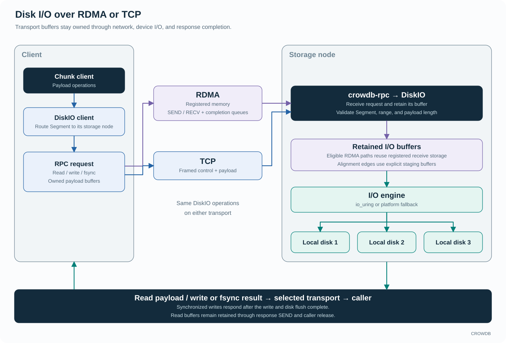

<!-- Copyright 2026-present Gian <crow.db@outlook.com> -->
<!-- Licensed under the Apache License, Version 2.0. -->

# CROWDB - Design: Disk I/O

DiskIO is the node-level byte service. It accepts addressed reads, writes, and synchronization requests, validates their ranges, and submits them to the storage backend. Its narrow responsibility gives the rest of CROWDB a common physical I/O interface.

`crowdb-diskio` is the C++ server. `crowdb-diskio-client` supplies the Rust client path. DiskDB owns allocation, and ChunkDB owns the layout that combines allocations into protected data.

## A short path from request to device

The client routes requests through `crowdb-rpc` over RDMA or TCP. RDMA uses registered memory, posted receives, and completion queues. On eligible aligned paths, the server passes registered receive storage into the disk engine without an extra payload staging copy. Reads can fill a retained registered buffer and send it back through the same transport. Alignment edges use explicit staging buffers. TCP exposes the same read, write, and synchronization operations.

The server works with `Segment` addresses and byte ranges rather than bucket keys or table files. A Segment identifies physical storage selected by the layers above it. DiskIO validates the addressed disk and range; the access and metadata services retain naming, ownership, and publication decisions.

At startup, the server tries io_uring when available and falls back to a blocking I/O thread pool if it cannot initialize that backend. Both expose asynchronous completion to the service. Queue depth, device behavior, and platform support still determine the useful level of concurrency.

## Completion has a precise owner

A read completes when the requested bytes are available to its caller. Write completion reports that the backend write finished; it does not by itself establish crash durability. A separate synchronization request completes the backend's durability barrier. Higher layers wait for the required writes and synchronization before acknowledging durable storage or publishing application metadata.

An S3 object becomes visible through S3 metadata, for example; DiskIO cannot infer that event from a finished device write. Keeping the byte service's result focused makes it reusable across payload, journal, and page-storage users.

Asynchronous I/O also gives buffers a lifetime beyond submission. The service and client retain the memory needed by accepted operations until the backend and transport are finished with it. Cancellation and shutdown must account for that accepted work before releasing resources.

## Why keep this path under CROWDB's control?

DiskIO connects device queues, RPC buffers, and the Chunk client's I/O schedule. Controlling those interfaces makes it possible to reduce unnecessary allocation and copying and to keep outstanding work bounded across the network/device boundary.

The blocking backend keeps the service usable when io_uring is unavailable. Performance measurements must identify the selected backend and device configuration because those choices change queueing and execution costs.

This focus comes with native-code and platform integration work. CROWDB keeps that work concentrated in the service and shared C++ utilities so the access models can remain independent of device details.

The [server source](../../app/crowdb-diskio/src), [client source](../../lib/crowdb-diskio-client/src), and [shared C++ utilities](../../lib/crowdb-common/cpp) are the main implementation entry points. [RPC](design-crowdb-rpc.md) explains the transport side of the data path.
