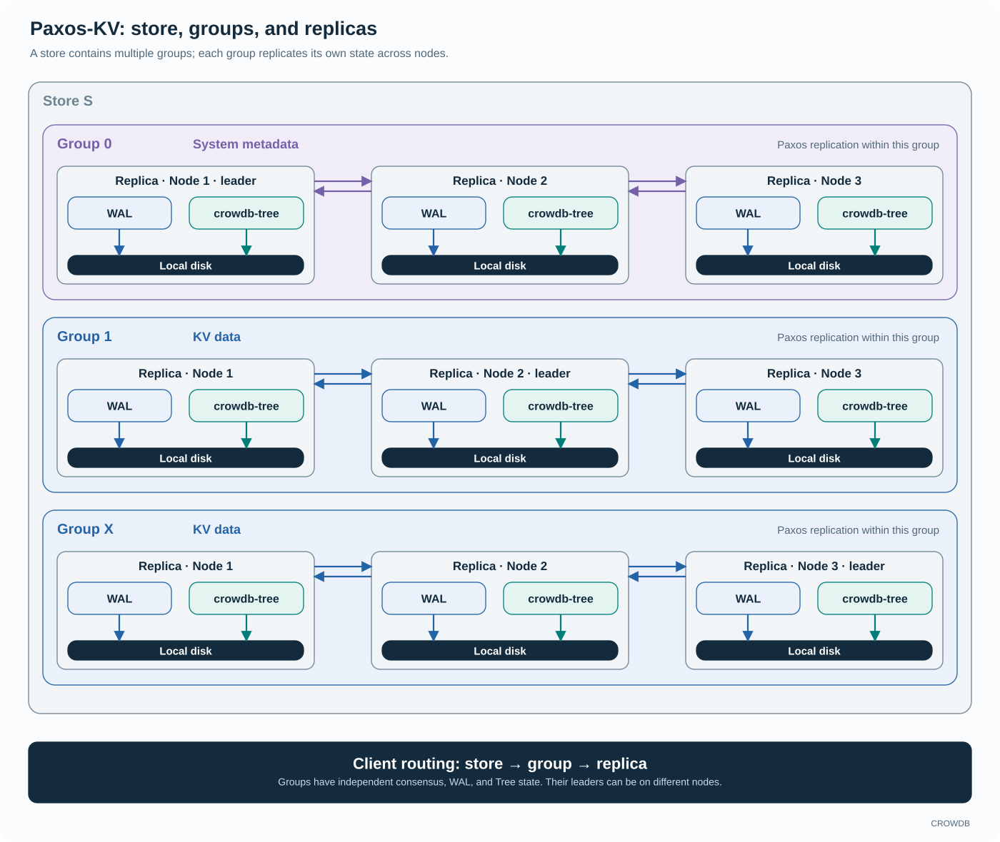

<!-- Copyright 2026-present Gian <crow.db@outlook.com> -->
<!-- Licensed under the Apache License, Version 2.0. -->

# CROWDB - Design: Paxos-KV

Paxos-KV is built around concurrent slot writes. Multiple writes can replicate, reach a durable quorum, and become chosen independently, while the Tree engine uses each key's slot to preserve the correct value when application finishes out of order. CROWDB carries concurrency through consensus and into storage, reducing the need for unrelated metadata updates to wait behind the same completion boundary.

`crowdb-paxos-kv` implements replication and the KV state machine. `crowdb-paxos-kv-server` hosts groups and their lifecycle. `crowdb-paxos-kv-client` routes application requests and handles service discovery. Group 0 is the system group and stores system metadata.

## Independent slots keep writes moving

The leader assigns slots in order and runs multiple proposals concurrently. Each slot is a separate Paxos decision with its own quorum progress. If slot N is delayed, N+1 and N+2 can become chosen without first filling that gap. A bounded in-flight window keeps that parallelism within the capacity of the WAL, network, and engine; recovery has its own path for resolving missing slots.

This is particularly useful for blind Put and Delete operations. Their effect is determined by the key and assigned slot, so the engine can apply available work immediately. The highest slot wins for a key, regardless of which write reaches the engine first. Two updates to different keys need not share a serial apply queue, and a late older update cannot replace a newer value.

Durability remains part of the write path: accepted values are durable on a quorum before the write is acknowledged. The synchronous path also waits for local apply; the asynchronous apply mode can acknowledge a chosen write while owned engine work continues. Linearizable reads enforce the appropriate apply fence before returning data.

## The advantage over an ordered-log write path

In Raft's replicated state-machine model, commitment advances through a contiguous log prefix and commands are applied in log order. Batching and pipelining improve replication throughput while retaining that ordering model. See the [Raft paper, sections 5.3 and 9.3](https://raft.github.io/raft.pdf).

CROWDB uses independent Paxos slots together with an engine that understands their ordering. Later blind writes can reach their own completion point while an earlier slot is still being resolved. This reduces head-of-line waiting where the operations do not require each other's results, and lets available network, WAL, and engine capacity serve useful work across many concurrent writes.

The benefit depends on the complete consensus-to-engine path. Simply replacing a consensus algorithm while retaining one serial apply queue would leave much of the opportunity unused. CROWDB designs slot agreement, per-key version selection, and parallel application together. Read-modify-write operations use additional coordination, and reads or maintenance that require a complete prefix still observe that boundary.

## Stores, groups, and replicas

A store contains multiple Paxos groups. Each group has its own replica set, consensus state, WAL, and Tree state. Replicas run on different nodes; one node can host replicas for several groups, and each group can elect a different leader. Clients route by store and group before choosing the appropriate replica.

Each replica writes its WAL and `crowdb-tree` state to local disks. Replication protects the group across nodes. Group 0 stores system metadata, while nonzero groups hold other KV data, including the metadata owned by storage services. A group remains a consensus and ordering boundary; application work spanning groups needs explicit coordination above it.

## Durable control state for the rest of the system

The WAL records the information needed to recover replication and accepted work. Tree materializes selected operations without adding another mutation redo WAL. Its durable snapshot coverage tells the KV layer which applied state is recoverable from the engine; the retained consensus history supplies the required suffix. This avoids duplicate engine logging while coordinating persistence and recovery through explicit progress. The [Tree recovery design](design-crowdb-tree.md#recovery-is-part-of-the-engine-contract) explains that shared contract.

This matters when many metadata writes are active at once. The quorum WAL makes accepted work durable, parallel apply updates the ordered index, and a later Tree snapshot consolidates durable state. The KV layer can advance these stages at different rates while retaining the history needed between them. It avoids inserting a second engine redo log into every mutation's path and can schedule checkpoint work around the same progress information used for recovery.

Group 0 relies on this recovery path for service registration, ownership, membership, and deployment decisions. Those decisions must survive the process that made them. A restarted monitor or service can recover them from durable metadata instead of reconstructing them from whatever happens to be running.

Recovery uses the same slot ordering as normal operation. Gap repair restores unresolved decisions; contiguous applied progress records which prefix is complete; snapshot-backed retention determines which history may be reclaimed. Those mechanisms preserve recovery information while the active write path exploits independent progress.

The [learner](../../lib/crowdb-paxos-kv/src/paxos/learner.rs) and [Tree adapter](../../lib/crowdb-paxos-kv/src/kv/crowdb_tree_engine.rs) show the connection. [Chunk-KV](design-crowdb-chunk-kv.md) explains the complementary shared-storage model.
