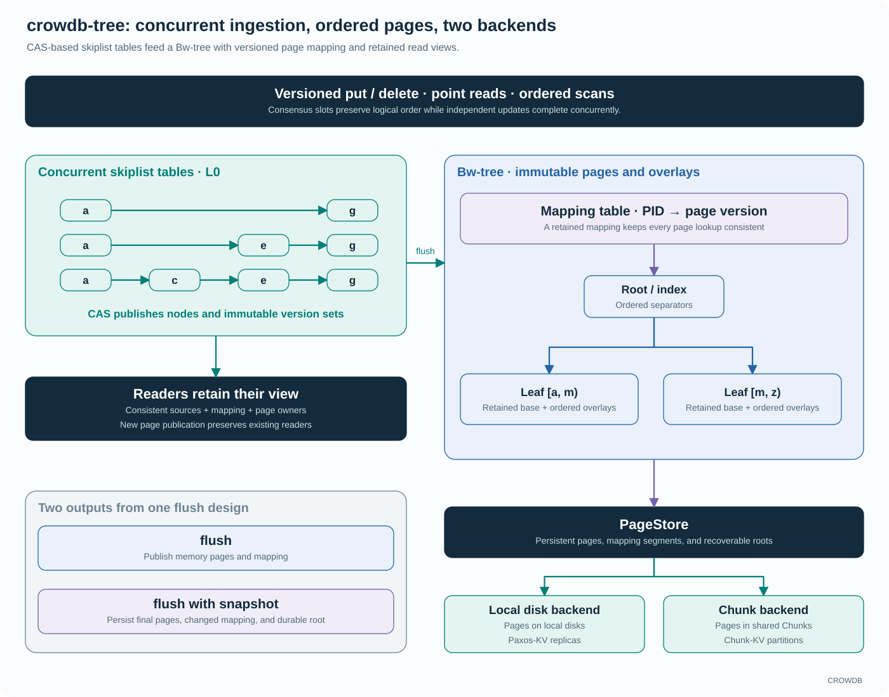
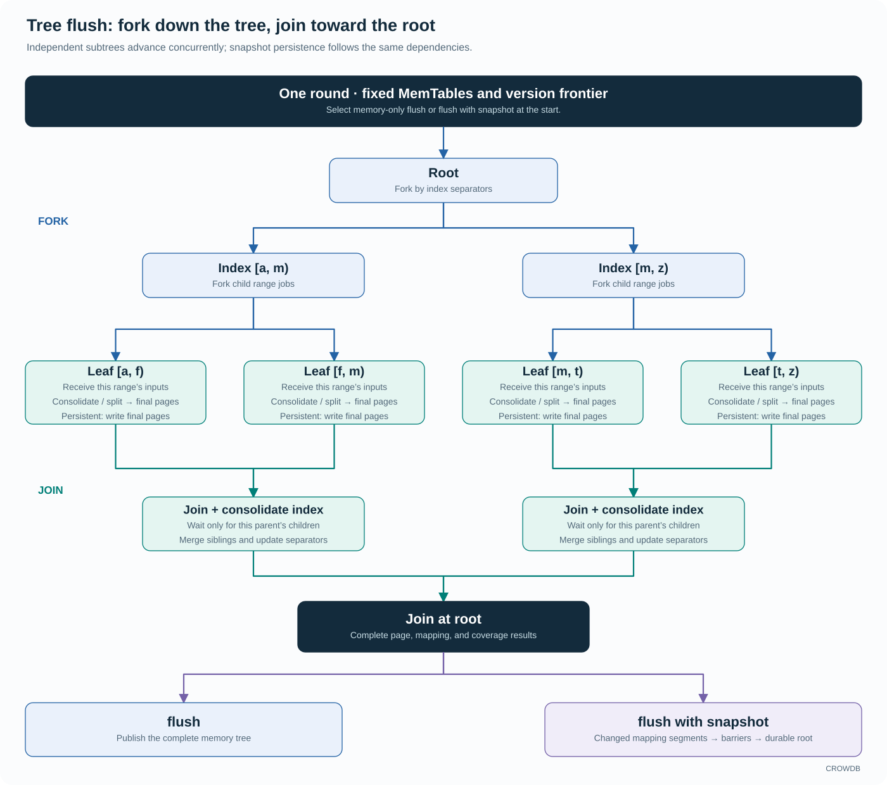

<!-- Copyright 2026-present Gian <crow.db@outlook.com> -->
<!-- Licensed under the Apache License, Version 2.0. -->

# CROWDB - Design: Tree Storage Engine

`crowdb-tree` brings concurrent skiplist tables, a Bw-tree architecture with a mapping table, and slot-aware version selection into one ordered KV engine. Its flush design follows the tree itself: fork work down independent subtrees, join results from leaves to root, and persist the same results when a snapshot is requested. The page backend can use local disks or shared Chunk storage.

These choices connect foreground concurrency, ordered reads, and background persistence. Paxos-KV uses the engine on each replica's local disks; Chunk-KV uses its Chunk backend to keep range state independent of the serving node. CROWDB can optimize the same engine for both storage models.

## Concurrent skiplists feed a versioned page tree

The write buffer is an ordered concurrent skiplist. CAS publishes new nodes and immutable version sets, while epoch protection keeps objects alive for readers. Multiple writers can update independent keys without putting every insertion behind a shared MemTable mutex. The skiplist's ordering also gives flush jobs range cursors directly, avoiding a fresh sort of the entire input batch.

The page tree uses mapping indirection: a logical page ID resolves to an immutable page version through a versioned mapping table. A page combines base data with ordered overlays. Readers retain a consistent mapping and source view while writers prepare newer state. A split can change routing and share retained base ranges without immediately copying every value into a new page buffer.

This keeps several expensive operations off the ordinary update path. Inserting a value need not rewrite a disk page; publishing a new page need not invalidate a reader's view; moving entries into the tree can transfer or share their existing allocation owners. Consolidation combines overlays and adjusts page boundaries when the structure needs it.

## Logical versions survive out-of-order application

Each key retains slot information and the versions needed by active read and recovery boundaries. An older update that finishes after a newer one cannot overwrite it merely by arriving later. Point reads and ordered scans select the highest eligible version, including tombstones, from the retained sources and pages.

That makes concurrency useful all the way through the replicated write path: consensus establishes logical order, while independent application work can finish in a different physical order. Paxos-KV builds user-facing conditional CAS operations from versioned reads and coordinated chosen writes; Tree's own CAS operations publish its concurrent in-memory state.

## Fork flush down the tree, join results toward the root

The flush design captures a finite set of skiplist tables and a fixed version frontier. Starting at the root, index separators divide the work into child ranges. Each leaf receives all captured updates belonging to its range, then consolidates as soon as its own inputs are ready. Independent subtrees can advance concurrently.

Join follows the reverse dependencies. A parent consumes its children's ordered results, resolves sibling merges and index changes, and returns its result upward. The design avoids a whole-tree handoff barrier before consolidation can begin. A ready subtree can produce its final pages while another branch is still receiving updates.

This is where the tree structure becomes a scheduling advantage. Parallelism follows key ranges and page dependencies, with bounded CPU and I/O work. Waiting for a child or storage completion yields the worker, allowing the shared runtime to advance other ranges and other Trees.

## Flush and flush with snapshot share the same work

Ordinary flush publishes the resulting pages and mapping in memory. Flush with snapshot selects persistent output for that same fork/join round. Final pages are encoded and written as their dependencies become ready; parents join those results, changed mapping segments are written once their entries are complete, and the durable root commits after its referenced output is safe.

The design shares consolidation, split/merge decisions, and final page layout between memory maintenance and persistence. Snapshot output therefore reuses the work already needed to organize the tree. Unchanged durable pages and mapping segments keep their existing backing, while a persistent round also includes dirty state left by earlier ordinary flushes.

Incremental persistence makes the amount of changed state matter more than total tree size. Memory-only maintenance can batch several update rounds before durable output, and the caller gets an explicit committed frontier for its WAL or journal retention policy. Resource budgets and backpressure keep that batching within the Tree's capacity.

## Recovery is part of the engine contract

Tree uses its caller's recoverable journal and does not create a separate mutation redo WAL. Paxos-KV supplies consensus-selected operations from its replica-local WAL; Chunk-KV supplies ordered mutations from its partition journal. The engine materializes those operations, preserving their version information and reporting the durable progress covered by a committed snapshot.

This removes a second recording of the same mutation inside the engine. The larger benefit is that application, persistence, and recovery share explicit progress boundaries. If a snapshot covers a prefix and later writes exist only in memory, recovery replays the required external journal suffix. A high observed slot or a completed page write cannot substitute for a committed root and its coverage.

For example, suppose the caller has completed operations through 120, while the last durable Tree root covers 100. Operations 101–120 must remain recoverable from the caller's journal. After a crash, the caller opens that root and supplies the valid suffix to Tree. In Paxos-KV, consensus determines which operations were chosen; Tree restores their materialized state using the supplied slots. Version selection, including tombstones, prevents an older replayed update from replacing a newer value.

Now suppose a snapshot starts persisting state through 120. Its page writes can finish at different times, but the recoverable boundary advances only when the root and its dependencies are committed. Until then, the previous root and required journal history remain the recovery path. This makes checkpoint publication the point where the caller learns that more state can be recovered from Tree itself.

The caller uses that durable coverage together with its replication and retention obligations to decide which journal history can be released. Tree manages the lifetime of its own pages and retained views. Each part supplies the evidence needed by the other, so memory maintenance, checkpointing, and log reclamation can be optimized together without confusing their completion points.

That coordination gives persistence room to batch useful work. Foreground writes can become recoverable through the external journal while Tree consolidates updates and persists changed pages in larger rounds. The engine avoids maintaining a second mutation log, and the caller can balance checkpoint work against the history retained for replay. A faster write path and a bounded recovery path become connected design decisions.

The same contract works with two different journals and two physical backends. It lets CROWDB reuse recovery-aware indexing while keeping consensus decisions and partition ordering with their respective KV services.

## One engine, local disks or shared Chunks

The local backend writes Tree pages and durable roots to local disks. Paxos-KV combines that local engine with replicated consensus and a local WAL on each replica.

The Chunk backend writes page data and roots through CROWDB's shared storage services. Chunk-KV can reopen the same durable backing from another serving node, reuse page state during range splits, and recover its WAL through ChunkStream. The ordered KV model above the backend stays the same.

This combination is the reason to own the engine. CAS-based ingestion, slot-aware reads, page indirection, subtree concurrency, and incremental persistence can be designed together with the distributed services that consume them. The same investment supports fast local replicas and movable shared-storage ranges.

See the [skiplist implementation](../../lib/crowdb-tree/src/memtable), [mapping table](../../lib/crowdb-tree/include/crowdb-tree/maptable), [C++ interface](../../lib/crowdb-tree/include/crowdb-tree/crowdb-tree.h), and [benchmark guide](../../lib/crowdb-tree/bench/README.md).
