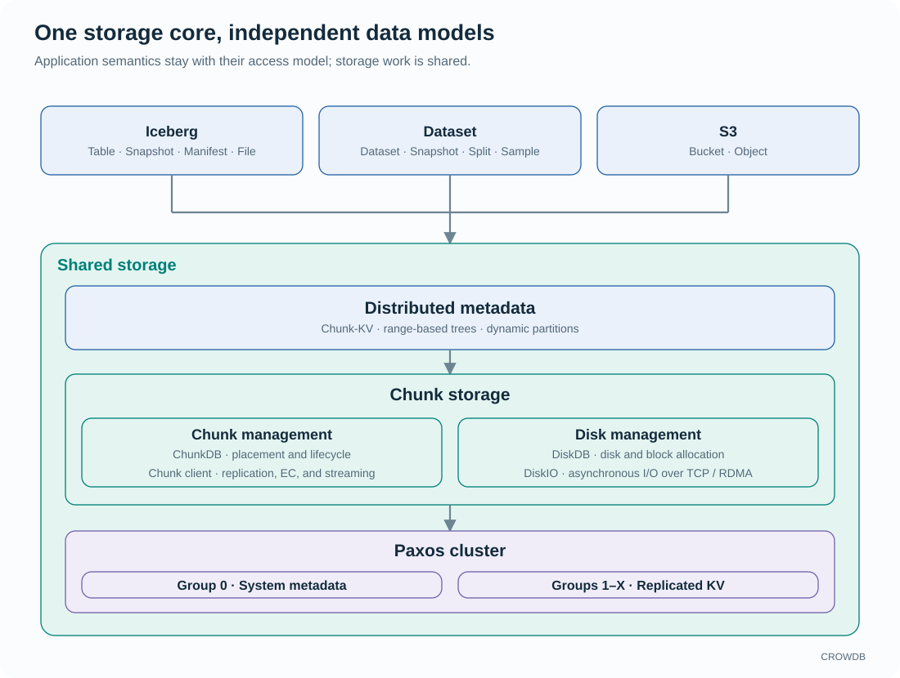

<!-- Copyright 2026-present Gian <crow.db@outlook.com> -->
<!-- Licensed under the Apache License, Version 2.0. -->

# CROWDB - Design: A Shared Storage Core for Tables, Datasets, and Objects

CROWDB brings Iceberg tables, AI datasets, and S3 objects onto one distributed storage core. Each has its own identity, publication rules, and read model. They share the machinery that places bytes, protects them, tracks ownership, and recovers after failure.

A table commit, a training batch, and a multipart object upload need different coordination. Beneath those differences lie the same expensive operations: moving buffers, allocating storage, recording durable state, and rebuilding data. CROWDB develops these pieces together so improvements to the storage path can benefit all three workloads.

## The workloads that shape the design

An analytical engine works with tables, snapshots, manifests, and files, using atomic commits to publish changes. It needs a catalog that understands table identity and a file path that can deliver large data files efficiently. CROWDB provides a native Iceberg catalog and storage integration; the analytical engine retains query planning and execution.

A training application works with selected samples and fields from a fixed dataset version. It needs workers to divide the input, resume progress, and avoid fetching unused payloads. CROWDB organizes datasets into immutable Snapshots, with Splits selecting samples and read continuations recording progress.

An object application wants a familiar bucket and key, streaming upload, range reads, and predictable behavior when a request fails. S3 compatibility lets existing tools use those operations without learning a new storage API.

These workloads combine large sequential transfers with many small metadata operations. Disk bandwidth alone cannot remove catalog contention, buffer copies, or recovery work. CROWDB addresses each cost in the component that controls it.

## Shared infrastructure, independent data semantics

Iceberg controls when table metadata becomes the current table state. Dataset controls which immutable Snapshot a read selects. S3 controls when an object becomes visible under its bucket and key. Sharing storage does not turn these into aliases for the same namespace. That distinction gives each access model room to improve without forcing its rules onto the others.

## The design advantages

**Native Iceberg removes a storage-system relay.** Table files live directly in Chunk storage, with no separate S3 storage backend. Native uploads return signed URIs carrying the Chunk location, so a manifest-selected data file can be read without another Iceberg file-metadata lookup. Catalog publication and file lifecycle are designed together, reducing the repeated metadata work that appears when independent systems are stacked. See [Iceberg](design-crowdb-access-iceberg.md).

**Small logical objects share large physical storage work.** Small files and field payloads retain independent identities while sharing Chunk allocation, batching, and write pipelines. Large writes get dedicated pipelines and chunks. This lets the system serve small metadata-heavy workloads and sustained bulk transfers without making every small item own a physical container. See [Chunk I/O](design-crowdb-chunkdb.md#two-write-paths).

**Dataset storage understands samples before it reads bytes.** Snapshots, Splits, field projection, and worker assignment select the input in metadata before payload transfer. Samples do not each need a filesystem file, and an unused field does not need to enter the training pipeline. Shared chunks address small-payload organization while continuations make repeated work explicit. See [Dataset](design-crowdb-access-dataset.md).

**Ordered names and distributed bytes work together.** Range metadata preserves the neighborhoods needed by prefix listing, pagination, and ordered scans. Chunk placement independently distributes the referenced payloads across nodes and disks. Names under one prefix can remain adjacent in the index while their data uses the storage cluster's capacity and bandwidth. See [Chunk-KV](design-crowdb-chunk-kv.md#ordered-names-do-not-constrain-payload-placement).

**Metadata serving can grow without first copying the whole index.** Chunk-KV reuses shared Tree pages during split and prepares a transfer destination from a pinned base and WAL suffix while the source continues serving. Adding a serving node does not require a full private copy of each range it takes over. Smooth split and transfer let serving capacity respond to load independently of physical Chunk relocation. See [Chunk-KV](design-crowdb-chunk-kv.md#serving-capacity-and-storage-capacity).

**Replicated metadata writes can complete across concurrent slots.** Paxos-KV lets each slot reach its own durable quorum, while per-key slot ordering keeps out-of-order Tree application correct. Independent blind writes can make progress before an earlier gap is resolved, reducing head-of-line waiting through the consensus and engine path. See [Paxos-KV](design-crowdb-paxos-kv.md).

**The engine's concurrency follows its data structure.** Tree combines concurrent skiplist write buffers, slot-aware versions, and a mapping table that separates page identity from page contents. Flush distributes work across independent subtrees and joins their results toward the root; a checkpoint persists the resulting state. Local-disk and Chunk backends let Paxos-KV and Chunk-KV share that engine investment. See [Tree](design-crowdb-tree.md).

**The journal and Tree form one recovery design.** Tree materializes work recorded by its caller without adding a separate mutation redo WAL. Slot-aware application, durable snapshot coverage, and retained journal history connect in one recovery path. This avoids duplicate mutation logging inside the engine and gives the caller the durable progress needed to decide what to replay and what history can be reclaimed. See [Tree recovery](design-crowdb-tree.md#recovery-is-part-of-the-engine-contract).

**Native access removes a payload relay.** Trusted Dataset and S3 applications embed the access libraries and communicate with storage nodes directly, using RDMA or TCP according to deployment policy. This removes an intermediate network hop and its protocol and staging work. The SDK delivers retained host buffers today; direct GPU-memory delivery is future work. See the [native SDK](design-crowdb-sdk-native.md).

These advantages reinforce one another. Ordered metadata selects the work, shared chunks aggregate it, direct I/O moves the bytes, and retained ownership carries them to the consumer. Resource budgets cover queued work, in-flight I/O, and buffers still held by an application, so slower consumers can apply backpressure through the path. Durable system metadata coordinates placement and recovery across it.

## Scope and adoption

CROWDB is a storage platform. Query execution, model training, and application transactions spanning unrelated data models belong to their respective engines and applications. Its Dataset fields hold application data; CROWDB does not prescribe tensor formats or execute a training graph.

Access Server hosts the network interfaces. The [container deployment design](design-crowdb-deployment.md) packages a Linux amd64 node as an OCI image, with Docker and containerd launch paths. Host networking and host block devices keep the I/O path direct; container limits control CPU and memory. The [Dataset HTTP SDK](../../sdk/README.md) and [native SDK](../../lib/crowdb-sdk-native/README.md) provide separate client distributions. Use the [repository README](../../README.md#run-crowdb) for deployment entry points and compatibility boundaries.

Continue with the [architecture](design-crowdb-architecture.md) or use the [component index](README.md) to explore a specific design.
